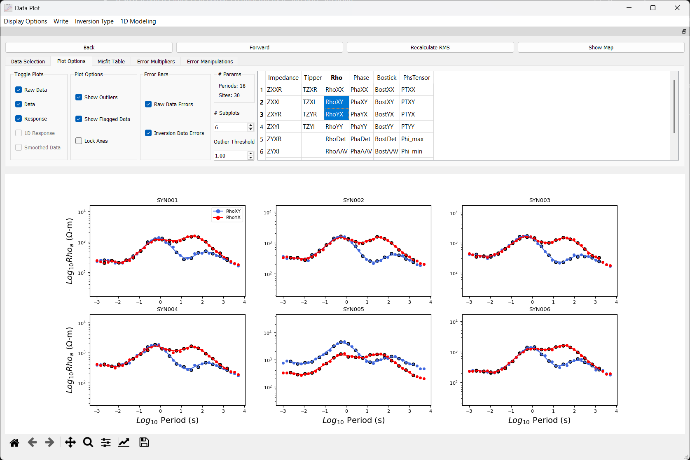
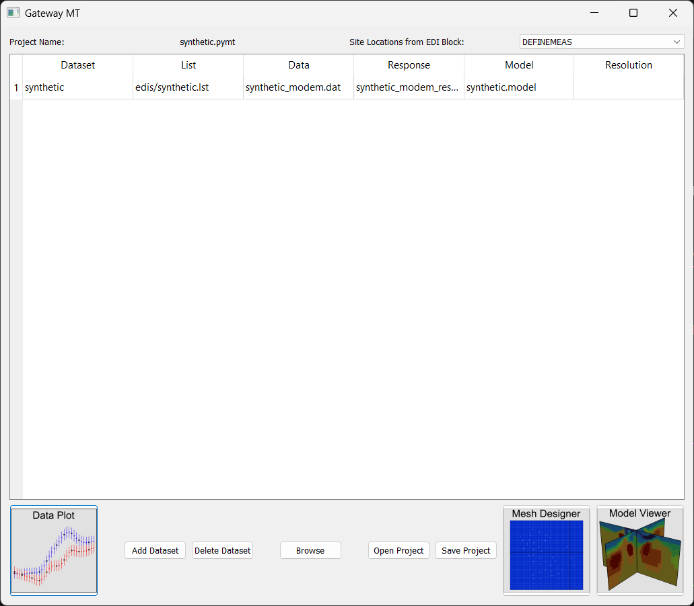
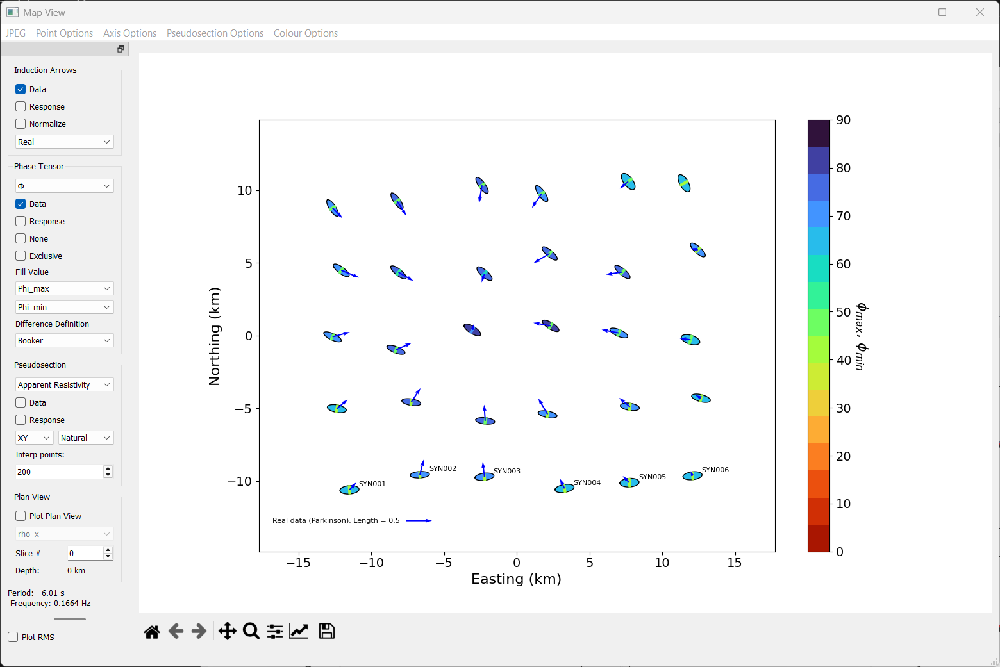
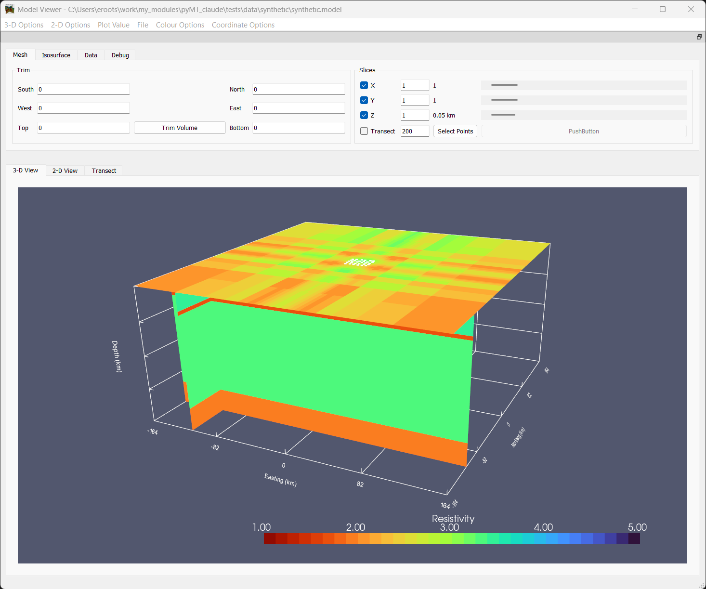
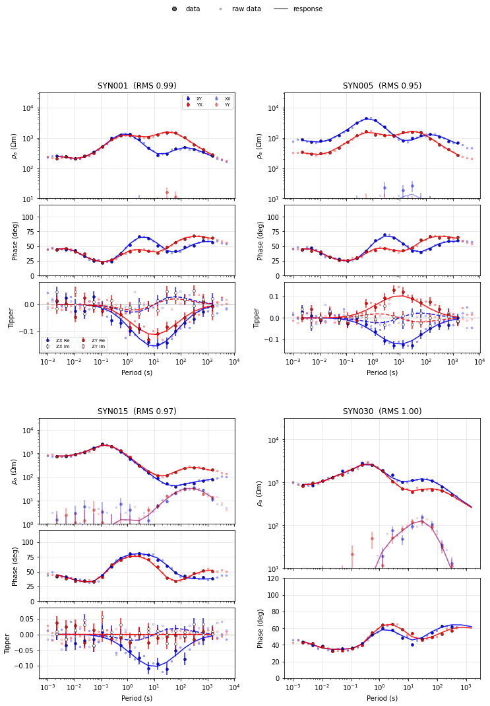

# gateway_mt

GUIs and command-line tools for visualization, analysis, and preparation of
magnetotelluric (MT) data for inversion. Reads and writes the data and model
formats of ModEM, GoFEM, WSINV3DMT, MARE2DEM, MT3DANI and EM3DANI, plus EDI
and j-format station files.

gateway_mt is the continuation of [pyMT](https://github.com/eroots/pyMT),
renamed to avoid confusion with [MTpy](https://github.com/MTgeophysics/mtpy-v2).



| | |
|---|---|
|  |  |
|  |  |

## What's in it

* **gateway_mt**: a project window holding the files for one or more datasets
  (station list, inversion data, response, model), which launches the GUIs below.
* **Data Plot**: inspect and edit data before and after inversion: sounding
  curves for any component, error floors and error maps, flagging points,
  rotating, period selection, misfit tables, and a map view with phase
  tensors, induction arrows and pseudosections. Writes the inversion data file.
* **Mesh Designer**: build and edit the model mesh and starting model.
* **Model Viewer**: 3-D and 2-D slices, isosurfaces and transects through an
  inverted model.
* **Command-line tools**: see below.
* **A Python library** (`gateway_mt.data_structures`, `IO`, `utils`, `gplot`) that
  the GUIs are built on, for scripting your own workflows.

## Installation

Tested method (Python 3.10 or newer):

1. Install Anaconda or Miniconda, and open an Anaconda prompt.
2. Create an environment for gateway_mt and activate it:

   ```
   conda create -n gateway_mt python=3.12 pip
   conda activate gateway_mt
   ```

3. Install gateway_mt:

   ```
   pip install git+https://github.com/eroots/gateway_mt.git
   ```

   Any time you want to update to the latest version, use

   ```
   pip install --upgrade git+https://github.com/eroots/gateway_mt.git
   ```

If you are also using pyMT, install gateway_mt in its own environment: both
packages install commands with the same names.

**Optional:** plan-view pseudosections use scipy's interpolators by default.
If you prefer natural neighbor interpolation, an updated version (compatible
with the latest versions of Python and numpy) can be installed via

```
pip install git+https://github.com/eroots/natural-neighbor-interpolation
```

Note that it requires the Microsoft Visual C++ Build Tools on Windows.

## Getting started

All of the GUIs (Data Plot, Mesh Designer, Model Viewer) can be accessed
through one main window. Navigate to your working folder (typically the
highest folder containing your MT data and workflow) and launch

```
gateway_mt
```

This GUI is essentially just a table containing all the files needed for a
series of datasets (where a dataset is any permutation of a list file, and
inversion data / response / model files). The list file is the only one which
you must create: it is a text file (with a .lst extension) containing the
list of EDI or j-format files to be read. You can use the `f2l` command to
create a list file containing all j-format and EDI files within a given
directory.

Double click a cell to manually type paths to relevant files, or highlight a
dataset (a row in the table) and click 'Browse' to select files. You may
select multiple files and the program will attempt to sort them into the
correct locations. Projects can be saved and reopened (`.pymt` files).

Once files have been added, highlight a dataset and click the 'Data Plot',
'Mesh Designer', or 'Model Viewer' buttons to launch the relevant GUI with the
highlighted dataset. Data Plot can load multiple datasets at once, so you can
easily compare data and/or models from different inversions.

### Try it on the test data

A small synthetic dataset (30 stations, with a response and a model) is
included in `tests/data/synthetic`:

```
cd tests/data/synthetic
gateway_mt
```

and open `synthetic.pymt`.

## Command-line tools

| Command | What it does |
|---|---|
| `f2l` | Write a list file of the EDI / j-format files in a folder. |
| `plot_edi` | Quick look at one or more EDI files (on screen, or saved as PNG / PDF). |
| `plot_dataset` | Plot raw data, inversion data and / or a response (any combination) to a PDF. |
| `autogen_report` | After an inversion: RMS summary (by component and station) plus a PDF of data vs. response. |
| `to_vtk` | Write a model and station locations to VTK for ParaView. |

Run any of them with `-h` for the options. For example:

```
plot_dataset -l all_sites.lst -d inv.dat -r inv_resp.dat -o fit.pdf
autogen_report -d inv.dat -r inv_resp.dat -m inv.model -o Report
```

## Using it from Python

```python
# run from tests/data/synthetic
import gateway_mt.data_structures as DS
import gateway_mt.utils as utils

ds = DS.Dataset(listfile='edis/synthetic.lst', datafile='synthetic_modem.dat',
                responsefile='synthetic_modem_resp.dat', modelfile='synthetic.model')
print('Total RMS: {:.2f}'.format(ds.rms['Total']))

site = ds.data.sites['SYN001']
rho, rho_err, _ = utils.compute_rho(site, calc_comp='xy', errtype='used_error')
```

`examples/` has scripts written for real projects (model slices,
pseudosections, phase-tensor maps, GeoTIFF / VTK export, ...). They are not
installed and need their paths edited, but show how to use the library.

## Repository layout

| Path | Contents |
|---|---|
| `gateway_mt/` | The package: data structures, file I/O, plotting, the GUIs and the command-line tools. |
| `examples/` | Project scripts using the library (see their README). |
| `tests/` | Test data (`tests/data/synthetic`, and the script that generates it) and regression checks. |
| `docs/` | User guides for each GUI (Sphinx). |

## License

GPL-3.0. See [LICENSE](LICENSE).
