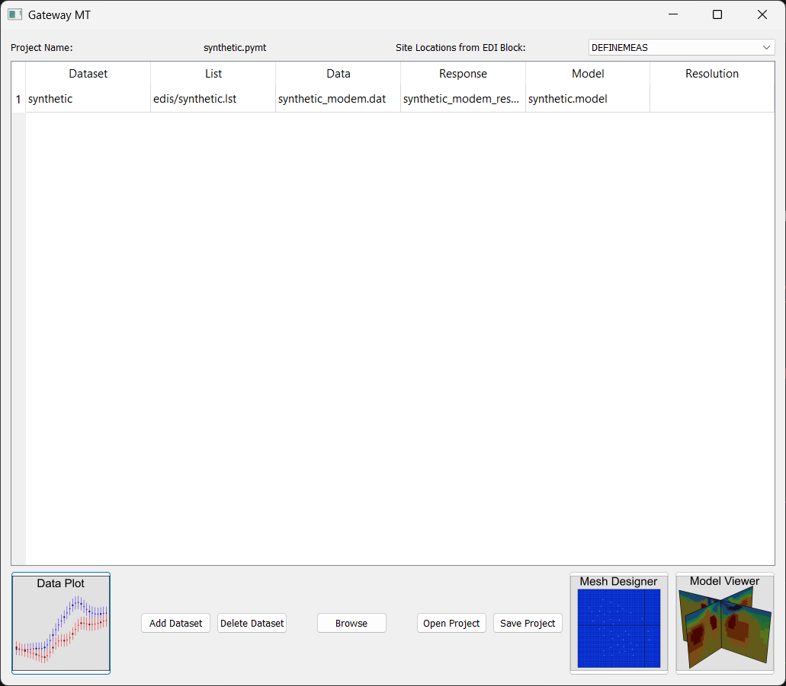

.. _First Project:

A First Project
===============

This page goes through a typical session from start to finish: setting up a
project in the Gateway window, looking at the data in :ref:`Data Plot`, and
opening the model in :ref:`Model Viewer` and :ref:`Mesh Designer`. It uses
the synthetic dataset that comes with the repository, so you can follow along
before trying your own data.

Get the example data
--------------------

The synthetic dataset is in the repository rather than the pip install, so
get a copy of the repository first (or download it as a zip from GitHub)::

	git clone https://github.com/eroots/gateway_mt.git
	cd gateway_mt/tests/data/synthetic

The folder holds 30 stations and a ModEM inversion of them:

* ``edis/``: the EDI files, plus ``synthetic.lst``, the :ref:`List File` naming them
* ``synthetic_modem.dat``: the inversion :ref:`Data File`
* ``synthetic_modem_resp.dat``: the inversion :ref:`Response File`
* ``synthetic.model``: the inverted :ref:`Model File`
* ``synthetic.pymt``: a finished project using all of the above (the one
  you are about to make)

With your own data, the only file you have to make yourself is the list
file. ``f2l`` writes one for every EDI and j-format file in a folder::

	f2l -d EDIs

which writes ``EDIs/all_sites.lst`` (use ``f2l -h`` for the options).

1. Start a project
------------------

From the folder with your data, launch::

	gateway_mt

It first asks for a project file. Type a new name (e.g. ``my_project.pymt``)
and confirm to start a new project; nothing is written until you save.
Choosing an existing ``.pymt`` file opens that project instead.

    The Gateway window with the finished project from this page.

The window is a table of datasets. Each row is one dataset: a name, plus
the list, data, response, model and resolution files that go with it. A new
project starts with one empty dataset, ``ds1``.

2. Fill in a dataset
--------------------

* Double click ``ds1`` and rename it, e.g. ``synthetic``.
* Click a cell in the row to select it, click **Browse**, and choose
  ``edis/synthetic.lst``. Then **Browse** again and choose
  ``synthetic_modem.dat`` and ``synthetic.model`` (CTRL+click to choose
  several files from one folder). Each file goes into the column for its
  type.
* Double click the **Response** cell and type ``synthetic_modem_resp.dat``.

  With your own inversions you can usually select the data and response
  files together: a ``.dat`` file whose first line mentions "response" (as
  ModEM's response files do: ``# ModEM impedance responses for ...``) goes
  into the Response column, and any other ``.dat`` file into the Data column.
  The example response here was written by gateway_mt, whose files don't say
  so, which is why it has to be typed in.

You don't need all four: a list file alone is enough to look at the raw
data, and a data file alone is enough to design a mesh. **Browse** fills in
full paths; paths you type can be relative to the project file's folder.
**Add Dataset** adds another row (e.g. a second inversion of the same data)
and **Delete Dataset** removes the selected rows.

'Site Locations from EDI Block' chooses where the station coordinates are
read from in the EDI files: the DEFINEMEAS block (the default) or the HEAD
block.

3. Save the project
-------------------

Click **Save Project** and choose a name. The project is a plain text
:ref:`Startup File`, so it can also be written or edited by hand. With the
paths typed relative to the project folder, it looks like::

	% synthetic
	list edis/synthetic.lst
	data synthetic_modem.dat
	resp synthetic_modem_resp.dat
	model synthetic.model

4. Look at the data in Data Plot
--------------------------------

Select the dataset and click **Data Plot**. Select several rows to load
several datasets at once, e.g. to compare two inversions.

Data Plot shows six stations at a time: raw data (from the EDIs) as filled
circles, the inversion data outlined in black, and the response as a line.
From here:

* step through the stations with the :ref:`Forward and Back Buttons`;
* choose what is plotted (apparent resistivity, phase, impedance, tipper,
  ...) in the :ref:`Data Component Table`;
* see how well the response fits in the :ref:`Misfit Table`;
* click **Show Map** (Plot Options tab) for the :ref:`Map Viewer`: station
  locations, phase tensors, induction arrows and pseudosections;
* add or remove periods, flag bad points, and change the error floors, then
  write a new inversion data file with Write > Data File (see :ref:`Menu Bar`).

5. Look at the model
--------------------

Select the dataset (one at a time here) and click **Model Viewer** for 2-D
and 3-D slices through the model, with the stations from the data file
on top. **Mesh Designer** opens the model's mesh (or, with only a data file,
a new mesh around the stations) for editing and writing a new starting model.

Next time
---------

Open the project directly with::

	gateway_mt my_project.pymt

or start ``mt_launcher`` in the project folder: it has a button for the
Gateway window, plus mtinv and mtplot if those are installed in the same
environment (see `gateway_mesh <https://github.com/eroots/gateway_mesh>`_).

Each GUI can also be started on its own, without the Gateway window. From the
project folder::

	data_plot -n my_project.pymt -c synthetic
	model_viewer synthetic.model synthetic_modem.dat
	mesh_designer synthetic.model synthetic_modem.dat
